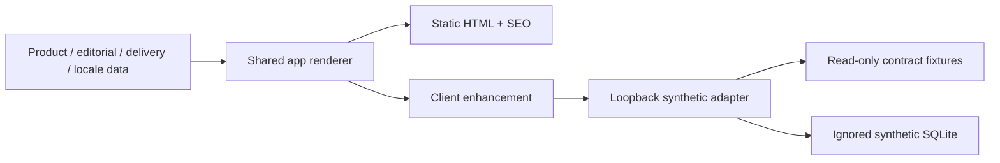

# Architecture and component map

The site uses native JavaScript modules, CSS and deterministic static HTML. It is not a React/Vue application and does not require a bundler or frontend package installation. Static render and client enhancement share one page renderer, so full content exists before JavaScript.

## Source ownership

| Area | Actual path | Editing guidance |
|---|---|---|
| Shell, header/mobile/footer, routes, catalog/search, gallery, configuration/cart/forms | `src/v36_2/app.mjs` | Markup may be refined; preserve selectors, data contracts, event binding and behavior. |
| Four home products | `src/v36_2/home-composition.mjs` | Preserve exact product order/meaning. |
| Retail discovery | `src/v36_2/public-catalog.mjs` | Six approved IDs only; not an art-direction setting. |
| Product identity/estimates | `src/v36_2/commerce.mjs` | Protected business contract; never edit prices for visual convenience. |
| Localized UI | `src/v36_2/i18n.mjs` | UA/EN/PL meaning and actions must remain equivalent. |
| Detailed product content | `src/v36_2/product-content.mjs` | Preserve418 sections/237 FAQ across the27 localized active-product records. |
| Product content renderer | `src/v36_2/product-content-view.mjs` | Preserve all text and payment/full-terms links. |
| Four in-place tabs | `src/v36_2/product-navigation.mjs`, `product-tabs.css` | Preserve keyboard semantics, focus and full no-JS fallback; do not restore anchor-only navigation. |
| About/How/design/general FAQ data | `src/v36_2/editorial-content.mjs` | Business facts and approved meaning are frozen. |
| Editorial rendering/placeholders | `src/v36_2/editorial-view.mjs` | Visual layout and truthful media placeholders may be refined. |
| Delivery data/rendering | `src/v36_2/delivery-content.mjs`, `delivery-view.mjs` | Full three-language terms,7sections plus FAQ; no new commercial promises. |
| Main design layers | `styles.css`, `visual-system.css`, `shop-design.css`, `editorial-design.css` | Start visual work here; inspect cascade before adding overrides. All within `src/v36_2/`. |
| Scoped component styling | `home-composition.css`, `editorial.css`, `owner-structure.css`, `product-content.css`, `product-navigation.css`, `email-proposal.css`, `media.css`, `media-owner.css` | Preserve responsive/focus/reduced-motion behavior. Some older selectors are retained compatibility CSS, not current IA. |
| Asset roles/gallery/HOLD | `src/v36_2/media.mjs`, `media-owner.mjs` | Original role ledger plus owner-decision overlay; see media register. |
| Actual local assets | `src/v36_2/assets/` | Approved main assets and local font licenses; no remote reference media. |
| Static metadata/schema/routes | `src/v36_2/seo.mjs`, `static-render.mjs` | Preserve canonical/hreflang, aliases, useful raw HTML and truthful Product/Service distinction. |
| v2 client/recovery/receipt | `src/v36_2/api-client.mjs` | Protected wire/digest/normalization/idempotency and receipt validation. |
| V36 email proposal | `src/v36_2/email-proposal.mjs`, `legacy-v36/` | Protected current-main v1/V36 contracts. |
| Publication/policy gates | `src/v36_2/release-policy.mjs`, `policy-digest.mjs`, `build-config.mjs` | Do not invent a B05 approval or enable production endpoints. |
| Explicit compiler | `scripts/build-v36_2.mjs` | Writes isolated outputs under `work/`; no publish side effect. |
| Safe local server | `tools/designer-preview.mjs` | Built-in Node24 SQLite; rejects real contacts, no outbound sender. |
| Pure mock dependencies | `designer/fixtures/gateway-contract/` | Read-only copies of only 8 pure contract files, not a gateway deployment. |
| Tests/fixtures | `tests/v36_2-*.test.mjs`, `tests/fixtures/`, `tools/designer-preview-test.mjs` | Synthetic regression, no real customers. |

The root's existing production frontend, server, legacy test infrastructure, media history and workflows remain in place. Do not delete them as unused designer files. No CRM or production database is bundled.

## Rendering and request flow

There is no connection from this local path to production CRM or notifications. Production integration belongs to a separately approved release plan.
